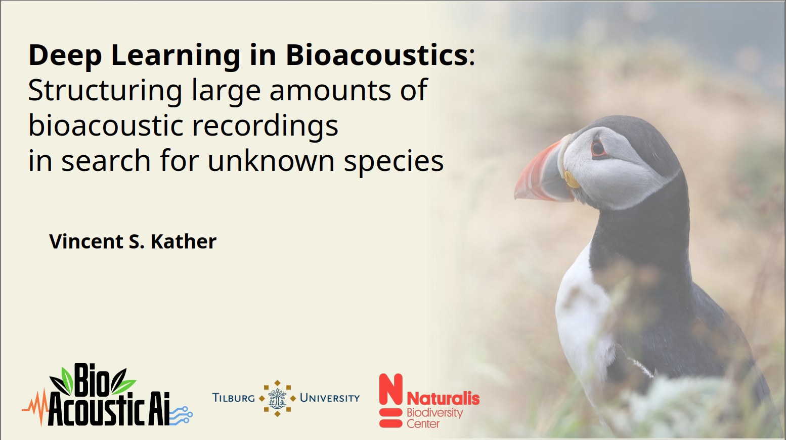

I work on animal sound using deep learning 🐸 
-- 
- PhD researcher
    - Leiden Institute of Advanced Computer Science (LIACS) 
    - Naturalis Biodiversity Center
- Maintainer of [bacpipe](https://github.com/bioacoustic-ai/bacpipe)
- Passionate about making bioacoustic ml accessible 🎤🐦 ([bacpipe-paper](https://doi.org/10.1111/2041-210X.70406))
- Always looking for collaborators, both coders and non-coders
- Find more at [siriusly.me](https://siriusly.me)

Watch my presentation at IRCAM to learn more about my research

